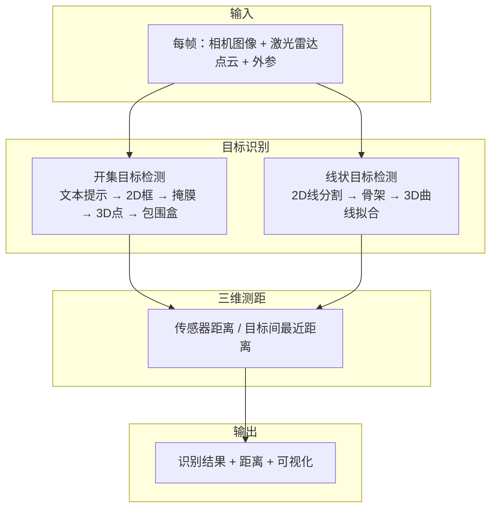
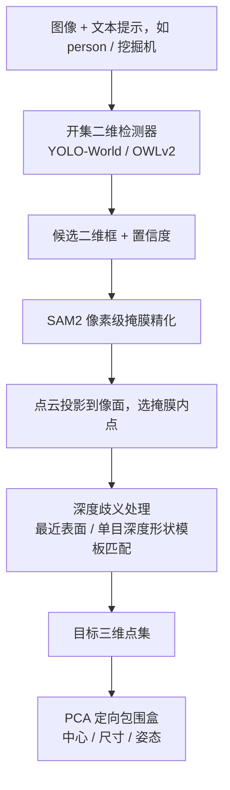
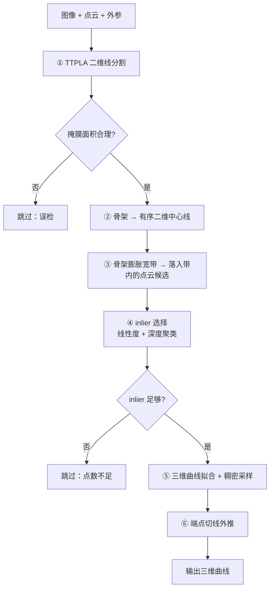
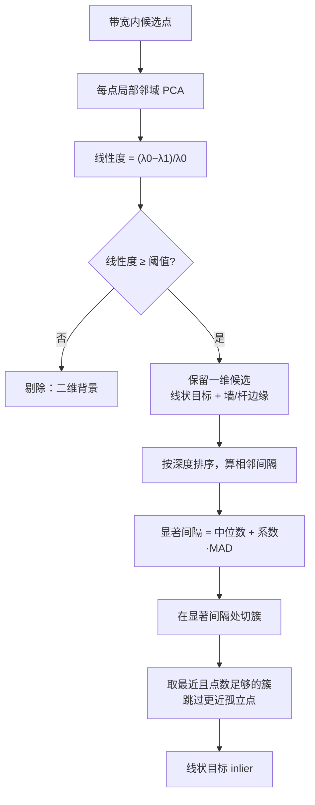
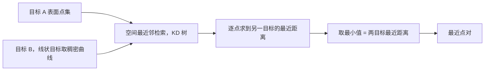
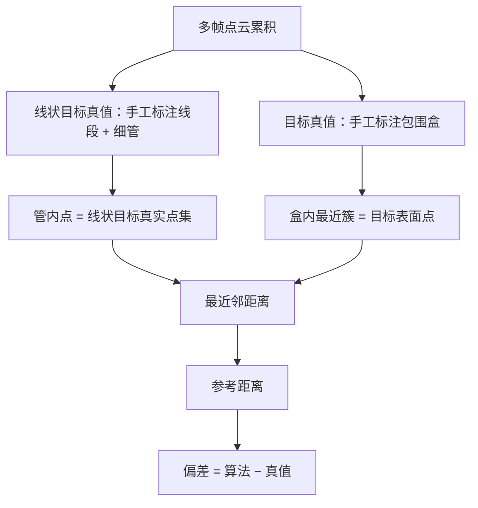

# 插图绘制源码 mermaid

> 本文档给出技术文档中图 1–6 的 mermaid 源码，供绘图软件或 mermaid 渲染器出图。
> 出图后放到 `figs/` 下，文件名与正文 `` 中的一致，再重跑 `md2docx.py` 即可嵌入。
>
> 图 7 / 图 8 / 图 9 / 图 11 是二维效果图，已直接嵌入，无需绘制；图 10 / 图 12–16 是点云截图，已由 `技术文档图/` 中的 MeshLab 截图处理并放入 `figs/`，无需再操作。

---

## 图 1 总体技术路线

---

## 图 2 开集目标检测流程

---

## 图 3 线状目标检测流程

---

## 图 4 线状目标 inlier 选择核心逻辑

---

## 图 5 三维测距计算

---

## 图 6 精度评估流程——独立手工真值基准

---

## 点云截图清单，图 10 / 图 12–16

已完成。下表记录每张截图对应的 `.ply` 源文件与最终放置位置，供日后重新截图时参考：

| 图号 | 打开的文件，相对 `wire_person_ranging/` 的路径 | 保存为 |
|---|---|---|
| 图 10 | `viz_intermediate/img_1700603346.892936/img_1700603346.892936_context.ply` | `figs/fig10_wire_context_ply.png` |
| 图 12 | `viz_intermediate_person/img_1700603346.892936/img_1700603346.892936_vggt_full.ply` | `figs/fig12_vggt_full_ply.png` |
| 图 13 | `viz_intermediate_person/img_1700603346.892936/img_1700603346.892936_p0_foreground.ply` | `figs/fig13_foreground_ply.png` |
| 图 14 | `viz_intermediate_person/img_1700603346.892936/img_1700603346.892936_p0_template.ply` | `figs/fig14_template_ply.png` |
| 图 15 | `viz_intermediate_person/img_1700603346.892936/img_1700603346.892936_p0_radar_clusters.ply`；选中簇另见 `..._p0_selected.ply` | `figs/fig15_radar_clusters_ply.png` |
| 图 16 | `viz_range_perframe/img_1700603346.892936/range.ply` | `figs/fig16_range_ply.png` |

> 提示：截图后重跑 `md2docx.py` 即可把占位图替换为真实截图。
