# 视觉—激光雷达融合的开集目标识别与三维测距技术方案

> 面向户外航拍俯视场景，对施工设备、人员、架空电线等目标进行识别，并测量目标之间、目标与传感器之间的三维距离，为安全距离预警等应用提供依据。

---

## 1. 应用场景与总体目标

### 1.1 应用场景

- **视角**：户外俯视航拍，例如无人机视角。
- **目标类别**：施工机械/设备、作业人员、架空电线/导线等——通过**文本提示**指定，可灵活扩展到任意开放类别。
- **典型需求**：测量“机械/人员到带电导线的安全距离”“设备与设备之间的距离”等。

### 1.2 系统目标

给定每帧的相机图像与激光雷达点云，系统输出：

| 输出 | 说明 |
|---|---|
| 目标识别结果 | 类别、3D 中心位置、3D 包围盒及其尺寸与姿态、置信度 |
| 传感器 → 目标距离 | 目标中心到传感器的距离 |
| **目标 → 目标最近距离** | 两目标之间的最小三维距离，包括线状目标；这是核心指标 |

### 1.3 关键技术挑战

1. **线状目标是点云中的少数派**：导线 2D 掩膜对应的点云候选里，地面、墙面等背景占绝大多数，直接拟合曲线会拟合到背景。
2. **单目深度对细线不可靠**：块状目标可用单目深度做形状先验，但细线在单目深度里几乎不可见，线状目标必须走纯几何路线。
3. **二维到三维选点的深度歧义**：沿相机射线选点会把目标背后的背景一并混入，需靠“最近表面”等几何先验剔除。
4. **方法需数据驱动**：判定阈值要从数据自身长出，避免绑定“导线离地 1.4 m”这类具体场景的绝对常量，保证可迁移到真实户外场景。

---

## 2. 总体技术路线

方案融合**相机与激光雷达**：相机提供二维语义，激光雷达提供三维几何，由两条互补的检测分支与一个统一测距模块构成：

- **开集目标检测分支**：文本提示驱动的开集检测器 → 像素级掩膜 → 点云选点 → 3D 定向包围盒，面向施工设备、人员等块状目标。
- **线状目标检测分支**：二维线分割 → 骨架 → 点云候选 → 数据驱动的 inlier 选择 → 三维曲线拟合，面向电线/导线等细长目标。
- **三维测距模块**：在激光雷达坐标系下，统一计算传感器距离与目标间最近距离。

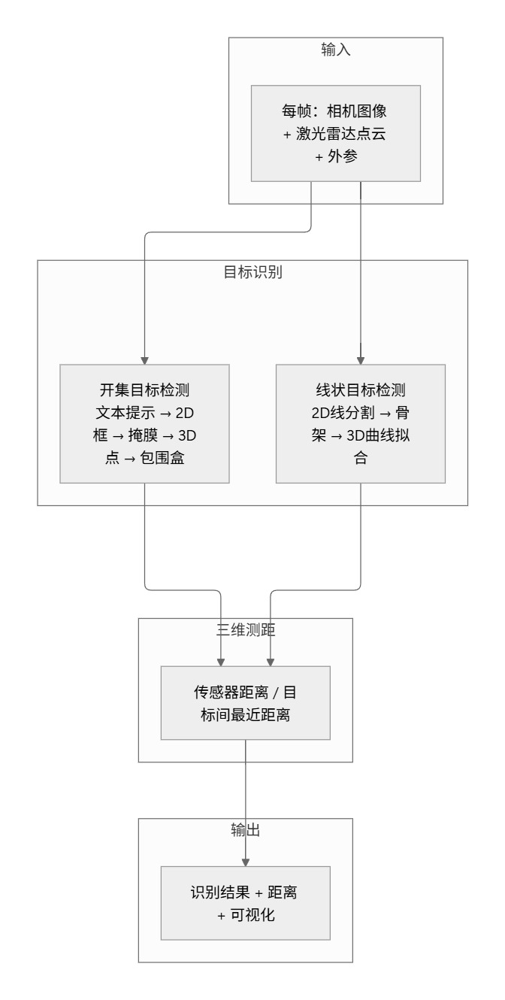

> **图 1** 总体技术路线

### 2.1 模块化与可替换性

方案按“检测—选点—几何计算”分层解耦，每一层都是可独立替换的模块，便于随部署环境、算力与精度需求升级组件：

- **开集检测器可替换**：当前使用 YOLO-World，可替换为 OWLv2 等其他开集检测模型，后续流程无需改动。
- **三维聚簇可替换为点云分割**：目前用无监督空间聚类把候选点分成目标簇，后续可替换为学习式点云分割网络，进一步提升簇的语义准确性。
- **其余模型同理**：掩膜精化、单目深度、线分割等环节所用的 SAM2、VGGT、TTPLA 均可替换为同类更强的模型，接口保持不变。

---

## 3. 传感器配置与坐标标定

### 3.1 传感器

| 传感器 | 作用 |
|---|---|
| 相机 | 提供目标类别、轮廓等高分辨率二维语义 |
| 激光雷达 | 提供位置、距离等稀疏但精确的三维几何 |
| 毫米波雷达，可选 | 提供逐像素深度，用于单目深度的尺度对齐 |

### 3.2 坐标变换

相机为针孔模型，内参已知；相机与激光雷达之间的刚体变换，即外参，已标定。通过外参把激光雷达点投影到像面，即可建立“图像像素 ↔ 三维点”的对应关系。

**关键设计——外参只用于“选点”**：外参仅用于决定“哪个三维点属于哪个目标”，而目标的三维位置、包围盒、距离全部由原始点云几何直接计算得到。因此**测距精度对外参标定误差不敏感**——即使外参存在一定误差，也只会影响选点的松紧，不会直接传导到距离数值。

### 3.3 坐标系约定

所有距离、位置均定义在以米为单位的**激光雷达坐标系**下：`x` 为前向、`y` 为横向、`z` 为高度。

---

## 4. 开集目标检测——以“人”为验证类别

该分支的核心能力是**开集检测**：通过文本提示指定任意目标类别，无需为每个新类别重新训练或标注，换类别只需改提示词。当前以“人”作为验证类别完成全流程测试。

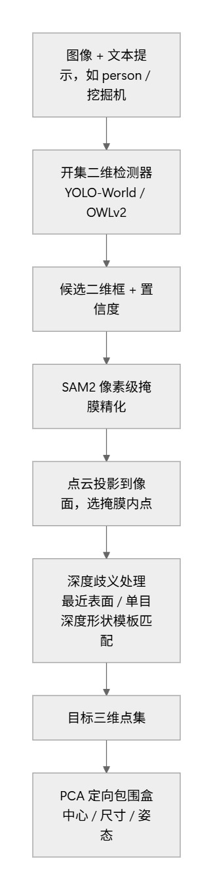

> **图 2** 开集目标检测流程

### 4.1 文本提示驱动的开集二维检测

开集检测器当前采用 YOLO-World，输入 `person`、`挖掘机`、`吊车` 等任意类别文本提示，输出候选二维框与置信度。文本与视觉特征对齐的机制使其能识别训练中未见过的类别。该检测器可替换为 OWLv2 等其他开集检测模型，后续流程无需改动。

### 4.2 像素级掩膜精化

用 SAM2 等分割大模型把二维框精化为贴合目标轮廓的像素掩膜，使后续三维选点更贴合目标本体、减少背景污染。

### 4.3 二维到三维的点云选择

将整帧激光雷达点经外参投影到像面，选取投影落入掩膜内的三维点作为该目标的候选点集。

### 4.4 深度歧义处理

沿相机射线选点会把目标背后的地面/墙面也混入候选。采用两级策略剔除：

1. **最近表面先验**：目标在遮挡关系中就是最近表面，因此对候选点做三维聚类后，取“最近深度”的簇作为目标本体。该三维聚类目前为无监督空间聚类，后续可替换为学习式点云分割网络，以进一步提升簇的语义准确性。
2. **单目深度形状模板匹配**，用于复杂背景：用单目深度在掩膜内重建目标的形状模板，再与各三维候选簇做尺度与平移不变的形状距离，即 Chamfer 距离，匹配取形状最接近的簇。该方法对单目深度的未知尺度与逐目标深度误差具有鲁棒性。

### 4.5 三维定向包围盒

对得到的目标三维点集做主成分分析 PCA，得到定向包围盒的中心、尺寸与姿态。目标中心即包围盒中心。

---

## 5. 线状目标检测——以“导线”为验证类别

电线、导线等线状目标细长、在点云中占比极小，且单目深度对细线不可靠，因此走**纯几何**路线，全部阈值数据驱动。

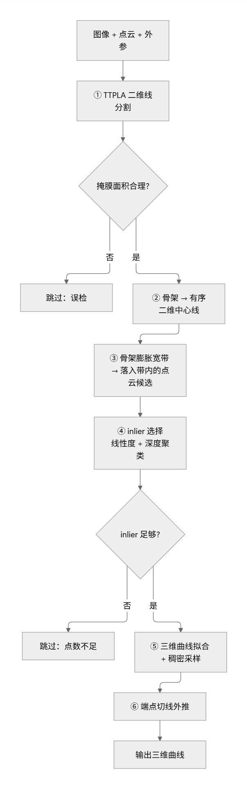

> **图 3** 线状目标检测流程

### 5.1 二维线分割

用线状目标分割模型 TTPLA 得到导线二维掩膜。若掩膜面积过大则判定为误检并跳过，防止全图误检。

### 5.2 骨架 → 有序二维中心线

将掩膜细化成骨架，并沿骨架提取**有序**二维中心线，以弧长参数化——这是后续“沿弧长拟合三维曲线”的基础。

### 5.3 宽带 → 点云候选

将骨架沿其法向膨胀为宽带，投影落入宽带内的激光雷达点作为候选点；每个候选点记录其三维坐标、相机深度，以及**最近骨架点的弧长**。

### 5.4 核心：数据驱动的 inlier 选择

这是线状目标检测的关键环节。候选点中绝大多数是背景，需两步筛选出真正的线状目标点：

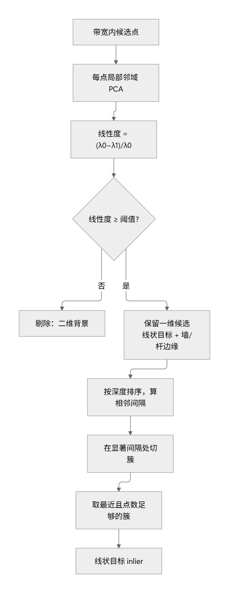

> **图 4** 线状目标 inlier 选择核心逻辑

**① 局部线性度筛选**：对每个候选点取其 k 邻域做局部协方差分析，计算线性度 `(λ0−λ1)/λ0`。线状目标局部呈一维结构、线性度接近 1；地面/墙面呈二维结构、线性度低。**邻域大小 k 是关键**：激光雷达沿扫描线采样，过小的邻域会让背景也“看起来”像一维结构；足够大的邻域才能暴露背景的二维本质，从而把稀疏的线状目标与背景分开。

**② 最近相干深度簇**：对筛选后的一维候选点按深度排序，在“显著间隔”处切簇——显著间隔的阈值由间隔数据的中位数与稳健方差 MAD 自动给出。取**最近且点数足够**的簇作为线状目标，同时跳过更近的孤立点，防止单点劫持“最近”。线状目标总是最近、最紧的深度簇。

### 5.5 三维曲线拟合与稠密采样

对筛选出的线状目标点按弧长排序，在 x/y/z 三通道分别做保形插值 PCHIP，得到以弧长为参数的三维光滑曲线，并稠密采样为曲线点集。

### 5.6 端点切线外推

线状目标顶端常超出图像范围、无激光雷达采样。沿端点局部切线方向对曲线进行短距离外推，补全图像外上段。

**输出**：激光雷达坐标系下的三维曲线，含端点外推。

---

## 6. 三维测距

在激光雷达坐标系下对两条检测分支的结果统一测距。

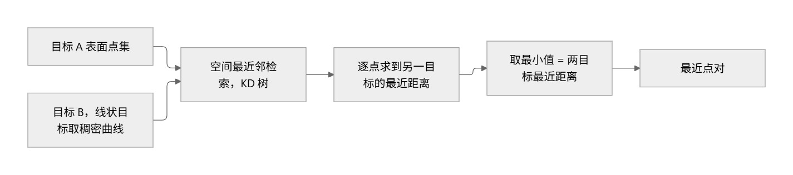

> **图 5** 三维测距计算

| 距离 | 定义 |
|---|---|
| 传感器 → 目标距离 | 目标中心到传感器原点的欧氏距离 $\lVert c \rVert$ |
| **目标 → 目标最近距离** | 目标 A 表面点集到目标 B 点集的最近距离，线状目标取其稠密曲线，取最小值 $\min_{p \in A}\text{dist}(p, B)$ |

测距对线状目标使用其**稠密曲线**、对块状目标使用其**表面点集**，通过空间最近邻检索，即 KD 树，计算最近点对与最小距离，得到两目标之间的真实最近三维距离。

---

## 7. 精度评估方法——独立手工真值

为客观评估测距精度，构建一套**完全独立于算法**的手工真值基准：

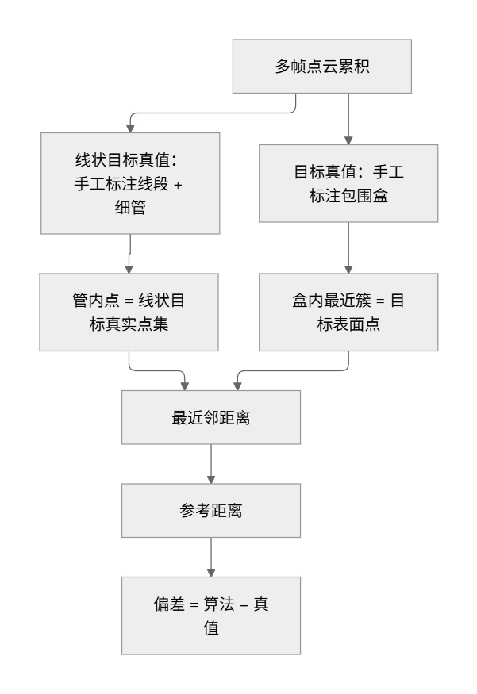

> **图 6** 精度评估流程——独立手工真值基准

- **线状目标真值**：线状目标近静止，将多帧点云累积后，手工标注其三维线段，取落在细管内的点作为“线状目标真实点集”。
- **目标真值**：手工标注目标三维包围盒，取盒内最近簇作为“目标表面点集”。
- **参考距离** = 目标表面点集到线状目标真实点集的最近距离。
- **偏差** = 算法结果 − 手工真值，据此统计 MAE / RMSE 等指标。

---

## 8. 实验验证与结果——测试数据

当前在 28 帧测试序列上完成验证，以“人”为块状目标、“导线”为线状目标。

### 8.1 主指标：导线到人体表面的最近三维距离，单位米

| | 均值 | 标准差 | 最小 | 最大 |
|---|---|---|---|---|
| 算法 | **0.840** | 0.035 | 0.731 | 0.910 |
| 手工真值 | 0.848 | 0.021 | 0.820 | 0.896 |

### 8.2 精度——算法 − 真值，共 27 帧

| 指标 | 值 |
|---|---|
| 平均偏差 | **−7 mm** |
| 平均绝对误差 MAE | **18 mm** |
| 均方根误差 RMSE | **29 mm** |
| 最大绝对偏差 | 102 mm |
| \|偏差\| < 3 cm | 23/27 帧 |
| \|偏差\| < 5 cm | 25/27 帧 |

剔除 2 个离群帧后，按 25 帧统计：MAE 13 mm、RMSE 16 mm、平均偏差 −0.9 mm。

### 8.3 成功与失败

- **27/28 帧成功**；1 帧因线状目标点过于稀疏，仅 4 个激光雷达点，故跳过。

### 8.4 离群帧分析

| 帧 | 算法 | 真值 | 偏差 |
|---|---|---|---|
| `img_1700603347.024661` | 0.731 | 0.832 | −0.102 |
| `img_1700603347.222660` | 0.786 | 0.860 | −0.074 |

两帧根因一致：线状目标**下端**贴地、邻域变为二维结构而被线性度筛选滤掉，下端靠切线外推；这两帧外推端向传感器方向漂移，误把更近的一处一维背景当作线状目标，导致距离偏小。

### 8.5 结论

平均偏差 −7 mm、MAE 18 mm、RMSE 29 mm；精度瓶颈集中在上述 2 个离群帧，其余 25 帧已达 MAE 13 mm / RMSE 16 mm 水平。

---

## 9. 可视化

本节按检测分支展示最终结果与关键中间结果。二维结果图直接嵌入；三维点云结果由 MeshLab 截图给出。

### 9.1 二维最终效果图

在图像上叠加目标框、线状目标曲线、最近点对连线与距离标注。图 7 为正常帧，算法测得导线到人体最近距离 0.905 m，与手工真值 0.896 m 基本一致；图 8 为离群帧，算法 0.731 m 相对真值 0.832 m 偏小，偏差来自线状目标下端漂移。

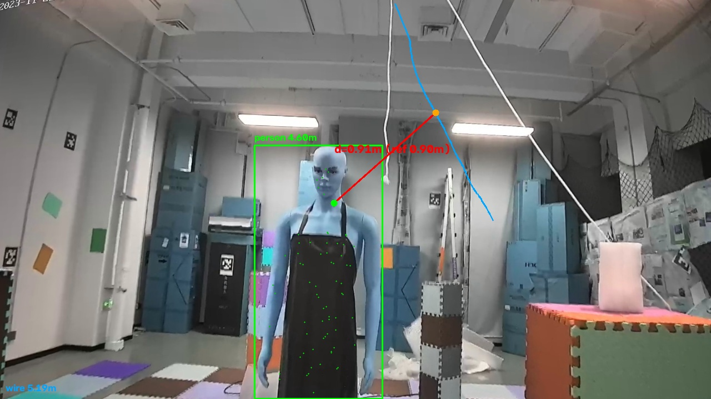

> **图 7** 测试帧二维测距效果

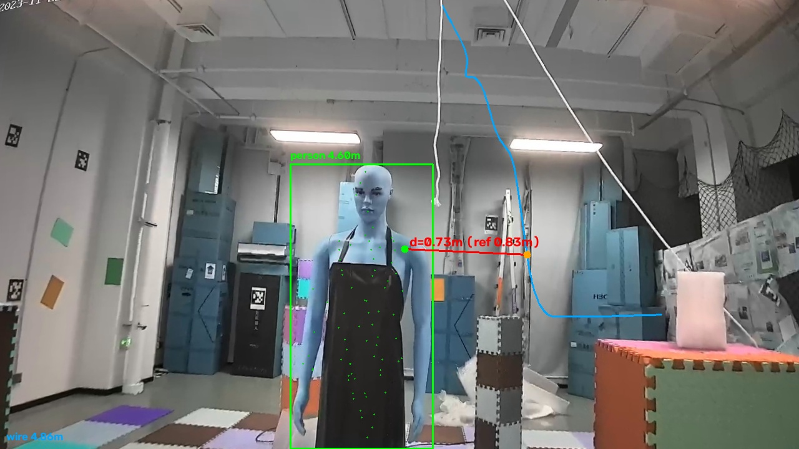

> **图 8** 离群帧二维测距效果

### 9.2 导线检测的中间结果

图 9 为 TTPLA 二维线分割结果：绿色为分割掩膜轮廓，红色为骨架中心线，橙色为落入膨胀宽带内的候选 inlier，灰色为被剔除的候选点。图 10 把二维分割落到三维点云上：灰色为整帧激光雷达点云，暗红色为被线性度与深度一致性筛选剔除的候选点，主要分布在地面与墙面；橙色为判定为线状目标的 inlier，沿导线走向排成一列；绿色为对 inlier 做保形插值后稠密采样的三维曲线，贯穿橙色 inlier 并补全图像外上段。

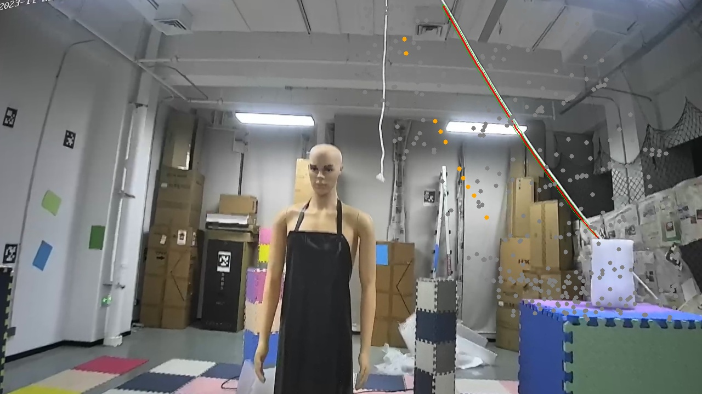

> **图 9** 导线二维分割与骨架

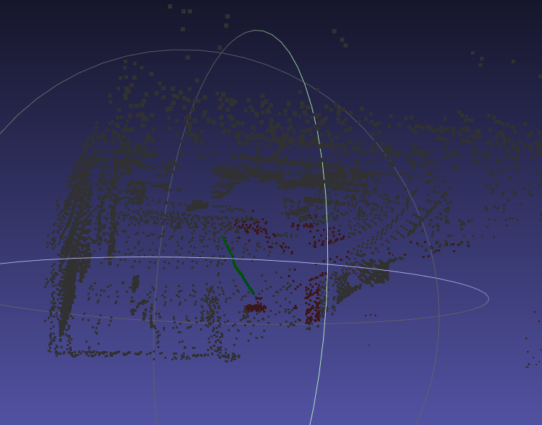

> **图 10** 导线三维检测结果

### 9.3 人体开集检测的中间结果

图 11 为二维检测框与 SAM2 像素级分割结果：绿色为掩膜，黄色为掩膜内“最近表面”深度模式像素，彩色大点为投影回像面的雷达候选聚类。图 12 为单目深度估计网络 VGGT 由单帧图像重建的全帧点云，颜色取自图像本身；其分辨率远高于激光雷达，用于重建目标的致密形状作为模板先验，但绝对尺度未知，只用于比较形状、不用于直接测距。图 13 是对全帧点云做目标级清理后的前景，依次经过“最近表面”划分、形态学开运算与统计离群点滤波，得到致密的前景点集，即形状模板的原始来源。图 14 是对前景做最远点采样下采样得到的形状模板，点数固定、分布均匀，作为目标的“形状签名”。图 15 是掩膜内激光雷达候选点经空间聚类得到的各簇，左侧不同颜色代表不同空间簇、灰色为噪声点，右侧为形状匹配选中的目标簇特写，绿色表示被选为人体本体的簇。

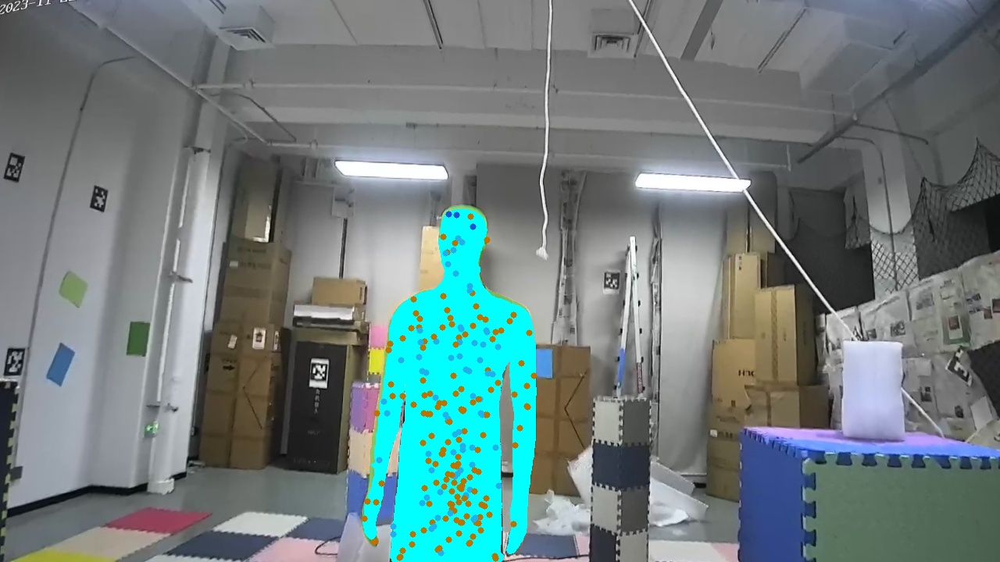

> **图 11** 二维检测框与像素级分割

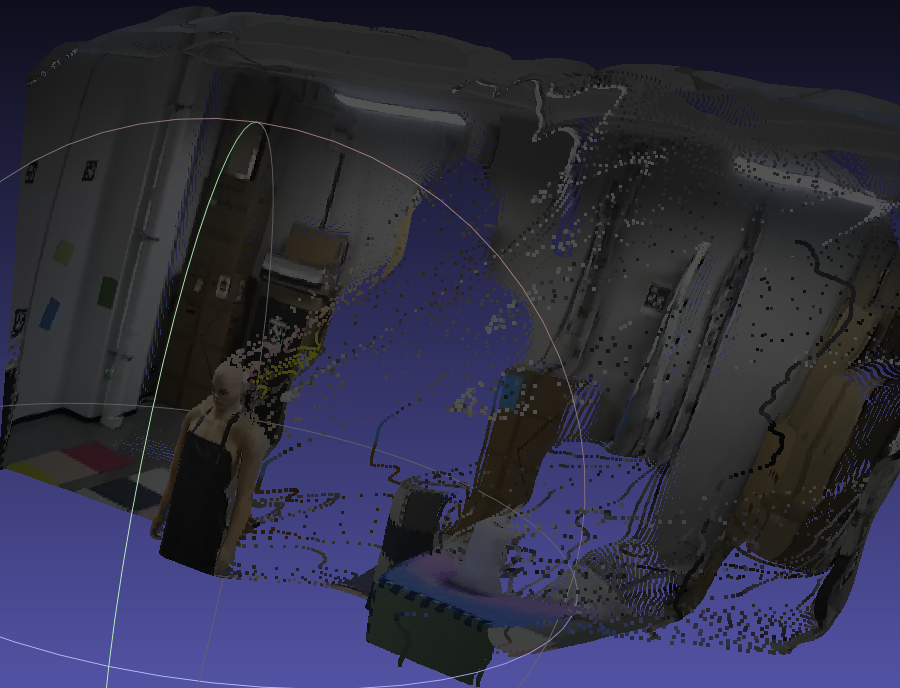

> **图 12** 单目深度估计点云

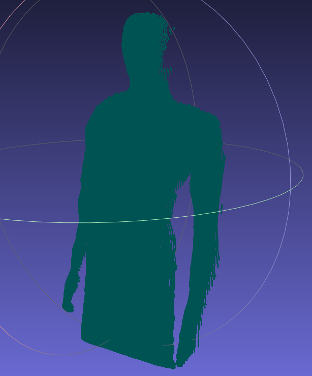

> **图 13** 处理后的前景点云

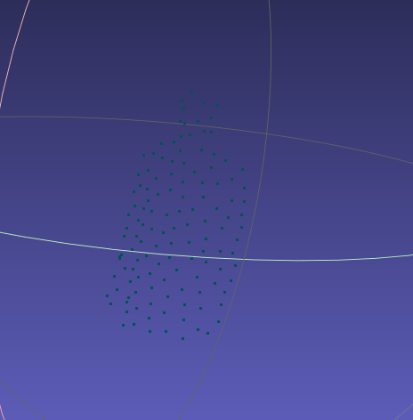

> **图 14** 形状模板点云

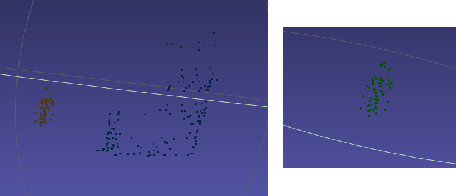

> **图 15** 雷达候选聚类与选中目标

### 9.4 最终三维点云可视化

最终结果在三维点云中着色显示：灰色为原始点云，绿色为识别出的人体表面点集，蓝色为拟合的导线三维曲线，红色为两目标之间的最近点对连线；最近点对的长度即导线到人体的最小三维距离，本帧为 0.905 m。

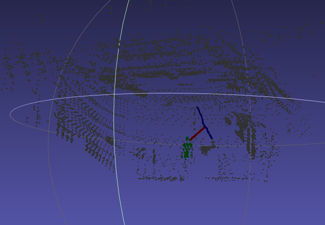

> **图 16** 最终三维测距点云

---

## 10. 局限与展望

1. **线状目标下端漂移**，这是当前主误差源：线状目标下端贴地、邻域二维化，靠端点外推，个别帧外推端漂移。改进方向：下端单独用更小邻域、加入深度连续性约束，或利用线状目标近静态的多帧约束。
2. **极端稀疏帧丢失**：线状目标点数过少的帧会跳过。改进方向：放宽判定或复用相邻帧。
3. **迁移到真实户外场景**：当前在测试数据上验证；下一步将整套流程迁移到户外航拍俯视场景，对施工设备、人员、电线实测，并扩充挖掘机、吊车等开集类别的验证。
4. **单目深度依赖**：形状模板匹配依赖单目深度，在极端光照/遮挡下会退化，已由“最近表面”先验兜底。
